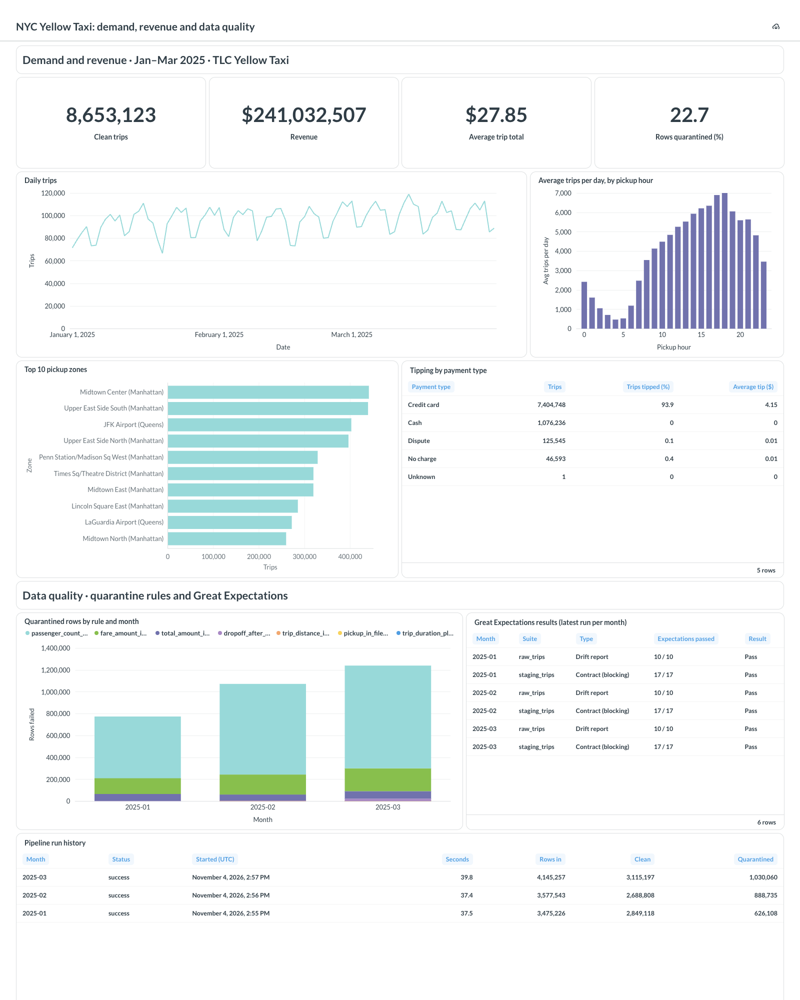
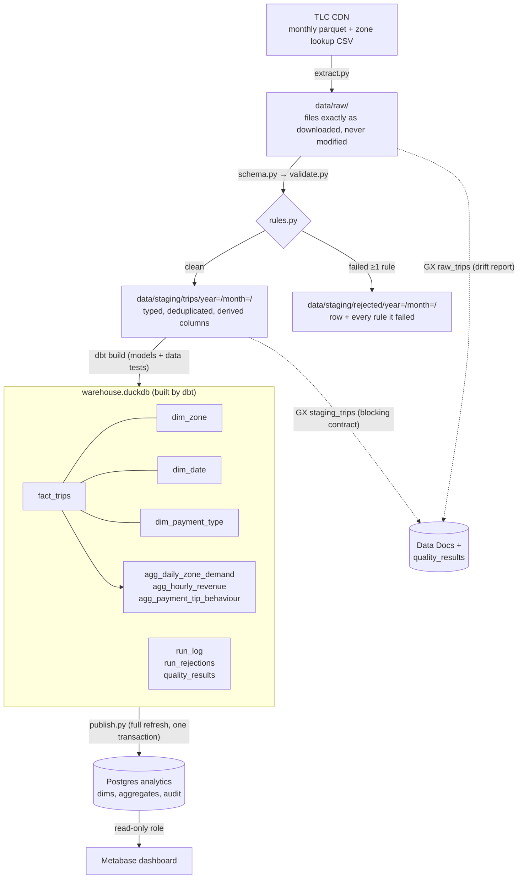
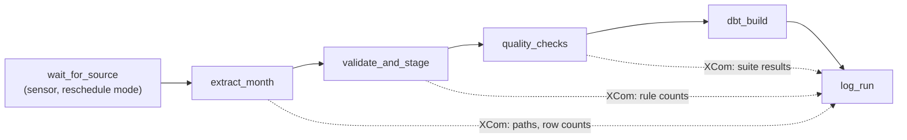
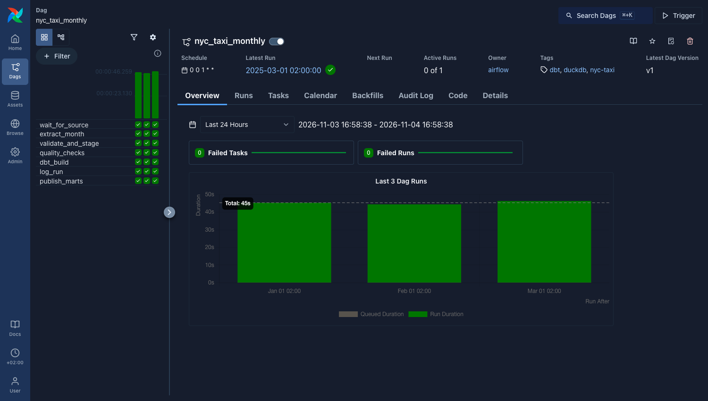
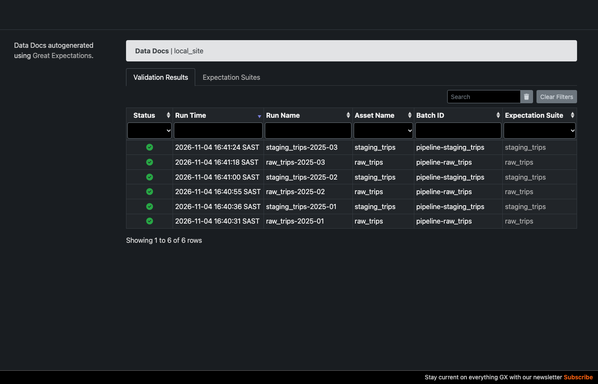
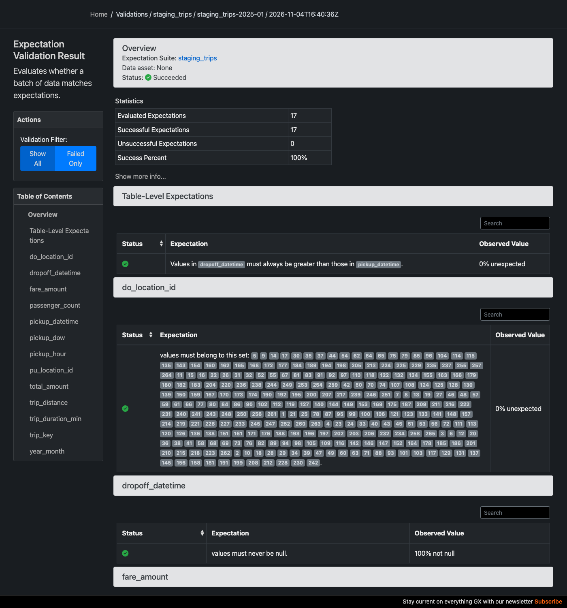
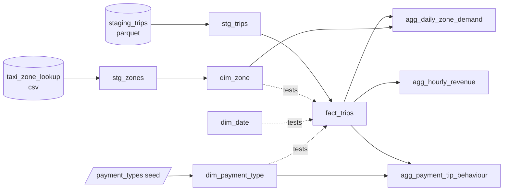

# NYC Taxi Pipeline

[](https://github.com/Emmanuel-Esplin/nyc-taxi-pipeline/actions/workflows/ci.yml)

> **Problem statement.** Ingest monthly NYC TLC Yellow Taxi trip data, validate and clean it,
> model it into an analytics-ready star schema, and produce reliable aggregates (demand by
> zone/hour, revenue, tipping behaviour), with reruns that are idempotent per month.

A batch pipeline in Python, DuckDB and dbt, orchestrated by Airflow, checked by Great
Expectations and served to a Metabase dashboard, all from one `docker-compose.yml`. Three months
of 2025 data (11.2M raw rows) load from scratch with one command. Rerunning a month replaces it
with exactly the same rows, and every rejected row is kept along with the reason it was
rejected.



## Architecture

Medallion layers on local storage. Each layer is partitioned by month, so a month can be
reprocessed without touching the other months.



| Stage | Module | What it does |
| --- | --- | --- |
| Extract | [extract.py](src/pipeline/extract.py) | Downloads the month's file and the zone lookup. Skips the download if a raw file of the same size already exists. Writes go to a `.part` file that is then renamed, so a crash never leaves a partial file behind. |
| Type | [schema.py](src/pipeline/schema.py) | Maps raw columns to snake_case names without regard to case, using `TRY_CAST`. Columns missing from older files become typed NULLs. |
| Validate | [rules.py](src/pipeline/rules.py), [validate.py](src/pipeline/validate.py) | Tags each row with every rule it fails, then splits the rows into clean and quarantined. |
| Transform | [transform.py](src/pipeline/transform.py) | Derives `trip_key`, `pickup_date/hour/dow`, `trip_duration_min` and `tip_pct`, then writes the month's staging partition. |
| Quality | [quality.py](src/pipeline/quality.py) | Runs two Great Expectations suites: a drift report on the raw file, and a blocking data contract on the staged rows. Results go to `quality_results` and Data Docs. |
| Model | [dbt.py](src/pipeline/dbt.py), [dbt/](dbt/) | Runs `dbt build` for the month: a seed, staging views, dimensions, an incremental fact table, incremental aggregates and 22 data tests. |
| Publish | [publish.py](src/pipeline/publish.py) | Copies the dimensions, aggregates and audit tables into Postgres for BI tools. |
| Orchestrate | [nyc_taxi_monthly.py](airflow/dags/nyc_taxi_monthly.py) | Airflow DAG with one run per month: wait for TLC to publish the file → extract → validate and stage → GX checks → dbt build → log the run → publish. |
| Dashboard | [bootstrap.py](metabase/bootstrap.py) | Builds the Metabase dashboard through Metabase's API. |
| Audit | [runlog.py](src/pipeline/runlog.py) | Adds one `run_log` row per run (including failed runs) and per-rule counts to `run_rejections`. |

## Running it

```bash
make install                              # .venv + dependencies (pinned by requirements.lock)
make run MONTH=2025-01                    # one month
make backfill START=2025-01 END=2025-03   # a range
make test                                 # unit + integration tests
make lint                                 # ruff
make dbt-build                            # rebuild + test every model over all staged months
make docs                                 # dbt docs with the lineage graph on localhost:8080
make quality-docs                         # Great Expectations Data Docs (every validation run)

# Docker: no local Python needed. Outputs land in ./data
make docker-run MONTH=2025-01
make docker-backfill START=2025-01 END=2025-03

# The full stack (docker compose): Airflow on :8080, Metabase on :3000
make secrets                              # once: creates the git-ignored .env with random passwords
make up                                   # Postgres, Airflow, Metabase
make airflow-backfill START=2025-01 END=2025-03   # each run ends by publishing to Postgres
make bi-bootstrap                         # build/update the dashboard; prints a public link
make down

# Pieces on their own
make airflow-up | make bi-up              # just Airflow, or just Postgres + Metabase
make publish                              # copy serving tables from a local (CLI) run
make screenshots                          # refresh the README images with headless Chrome
```

You can also call the CLI directly with `python -m pipeline run --month 2025-01` or
`--start 2025-01 --end 2025-03`. Settings live in [config.yaml](config.yaml) and contain no
hard-coded paths. Paths can be overridden with `PIPELINE_DATA_DIR`, `PIPELINE_WAREHOUSE_PATH`,
`PIPELINE_DBT_DIR` and `PIPELINE_SOURCE_DIR`. The last one points at a folder of
pre-downloaded files, which is how the tests and CI run offline.

> **macOS note:** if the repository is in an iCloud-synced folder (Desktop or Documents with
> "Optimize Mac Storage"), iCloud can offload files in `.venv/` and `data/`. Python then
> hangs reading them, and Docker can't read them at all. Keep both out of sync by renaming
> them with a `.nosync` suffix and symlinking them back:
> `mv data data.nosync && ln -s data.nosync data` (git already ignores both).

## Orchestration (Airflow)



- **One DAG run per month.** The schedule is `@monthly` with `catchup=True` from
  `PIPELINE_START_MONTH`, so turning the DAG on backfills every month since then, and each new
  month is picked up automatically. `PIPELINE_END_MONTH` sets an upper bound, and the
  `month` param re-processes one specific month from the UI.
- **The DAG waits for TLC to publish.** TLC releases each month about two months late, and its
  CDN returns 403 until the file exists. The sensor checks every 12 hours, for up to 90 days,
  in `reschedule` mode, so it doesn't hold a worker slot while it waits.
- **One data task at a time, enforced by a pool.** DuckDB allows a single writer, and
  validating a month needs a few GB of memory. Every data task runs in the one-slot
  `nyc_taxi_pipeline` pool. `max_active_runs=1` is not enough: Airflow 3 backfills have their
  own concurrency setting and ignore it. An early backfill here ran three months at once,
  which caused DuckDB lock errors and an out-of-memory kill. The sensor stays outside the
  pool, so waiting for TLC never blocks other work.
- **Tasks call the same stage functions as the CLI** (`pipeline.pipeline`), so
  `make run` and Airflow behave the same way. Tasks pass only small JSON values (paths and
  counts) through XCom. The data stays on the shared `./data` volume.
- **Failures are logged.** An `on_failure_callback` writes a `failed` row to `run_log` naming
  the task and the error, and tasks retry twice, 10 minutes apart. `PIPELINE_TASK_RETRIES`
  can lower this, and CI sets it to 0.
- **dbt has its own virtualenv in the Airflow image**, because its dependency pins conflict
  with Airflow's. The pipeline calls it through `PIPELINE_DBT_BIN`.
- **CI runs the DAG for real.** The `Airflow DAG test` job builds the image, checks the DAG
  imports cleanly, runs `airflow dags test` on the fixture month, and asserts what landed in
  `run_log` and `fact_trips`.



## Serving and dashboard (Postgres + Metabase)

**DuckDB is the warehouse; Postgres is the serving layer.** DuckDB lets only one process write,
and a writer locks every other process out of the file. A dashboard holding
`warehouse.duckdb` open would therefore block the pipeline, and a load would break the
dashboard. So the last task of each run, `publish_marts`, copies the serving tables
(dimensions, aggregates, `run_log`, `run_rejections` and `quality_results`, about 23k rows)
into a Postgres `analytics` database. Metabase reads it with its built-in Postgres driver,
with no third-party DuckDB plugin. `fact_trips` (8.65M rows) stays in DuckDB.

- **Atomic full refresh.** Every publish drops and recreates the tables inside one Postgres
  transaction, so the dashboard sees either the previous version or the new one, never a
  partial one. It takes about 3 s.
- **Least privilege.** [setup-serving.sh](docker/postgres/setup-serving.sh) creates three
  roles: `analytics_writer` (the pipeline), `metabase_reader` (SELECT only, including on tables
  created later, via default privileges) and `metabase_app` (Metabase's own database). It is
  idempotent, so it runs on every `docker compose up`.
- **Publishing is separate from loading.** If Postgres is down, the month still loads and is
  still logged, and `publish_marts` retries on its own. Without `PIPELINE_SERVING_URL`
  (CLI runs, CI fixtures) publishing is skipped.
- **The dashboard is code.** [metabase/bootstrap.py](metabase/bootstrap.py) (standard
  library only) completes Metabase's first-time setup, connects the database through the
  read-only role, and creates or updates 11 native-SQL questions and the dashboard layout.
  Re-running it updates the same objects in place, and the README screenshot is taken from the
  dashboard's public link.
- **Secrets stay local.** Every password and secret (the Postgres roles, the Metabase admin
  and Airflow's JWT secret) comes from a git-ignored `.env`. `make secrets` generates it with
  random values ([make_secrets.py](scripts/make_secrets.py)) and never overwrites values that
  are already set. The repo holds no defaults: `docker compose` refuses to start and
  `bootstrap.py` exits if one is missing. To rotate a database password, edit `.env` and
  `docker compose up` (postgres-setup re-applies role passwords each run). To rotate the
  Metabase admin, set the new `MB_ADMIN_PASSWORD`, run `make bi-bootstrap` once with
  `MB_ADMIN_PREVIOUS_PASSWORD` set to the old one, then delete it.
- **Timestamps are UTC.** `run_log` used to record local time on a laptop and UTC in
  containers, which the dashboard's run history exposed. Every timestamp is now naive UTC
  (`runlog.utcnow()`).

## Data quality rules

Rules are SQL predicates that are TRUE when a row **fails**. A NULL result also counts as a
failure: if a row can't be shown to be valid, it is quarantined. Thresholds are set in
`config.yaml`.

| Rule | Check | 2025-01 | 2025-02 | 2025-03 |
| --- | --- | ---: | ---: | ---: |
| `pickup_in_file_month` | Pickup falls inside the file's month | 22 | 31 | 33 |
| `dropoff_after_pickup` | Dropoff is strictly after pickup | 2,051 | 5,164 | 22,280 |
| `trip_duration_plausible` | Trip lasts < 24 h | 20 | 16 | 11 |
| `fare_amount_in_range` | 0 ≤ fare ≤ 1,000 | 144,121 | 182,661 | 208,729 |
| `trip_distance_in_range` | 0 ≤ distance ≤ 200 mi | 122 | 151 | 179 |
| `total_amount_in_range` | 0 ≤ total ≤ 1,500 | 63,039 | 55,183 | 68,689 |
| `passenger_count_positive` | passenger_count present and > 0 | 564,805 | 828,688 | 939,378 |
| `pickup_zone_known` / `dropoff_zone_known` | Location ID is in the zone lookup | 0 | 0 | 0 |
| `not_duplicate` | First occurrence of the natural key | 0 | 0 | 0 |
| **Rows in → clean** | | **3,475,226 → 2,849,118** | **3,577,543 → 2,688,808** | **4,145,257 → 3,115,197** |
| **Rejected** | | **18.0%** | **24.8%** | **24.8%** |

A single row can fail several rules, so the per-rule counts add up to more than the number of
rejected rows. In this data, the zone and duplicate rules never fire. They still matter as
guards, and the test fixture includes synthetic rows to prove they work.

Every run is reconciled: the row count in the raw file's parquet footer must equal the rows
read, clean rows must equal staged rows, and staged rows must equal the rows loaded into
`fact_trips`. If any count doesn't match, the run fails and is logged as `failed`.

## Great Expectations: drift report and data contract

`rules.py` decides which rows are quarantined. Great Expectations
([quality.py](src/pipeline/quality.py)) sits next to it at the raw → staging boundary and does two
different jobs:

| Suite | Runs on | Blocks the run? | Purpose |
| --- | --- | --- | --- |
| `raw_trips` | the raw TLC file | No (`severity: warning`) | **Drift report.** Loose `mostly` thresholds, such as "passenger_count is null on fewer than 30% of rows". Bad raw rows are expected, and quarantine handles them. The suite shows when the source changes enough to deserve a look. |
| `staging_trips` | the staged (clean) rows | **Yes** | **Data contract.** Every validation rule must hold for 100% of staged rows, plus checks the rule engine doesn't make: `trip_key` unique, `year_month` correct, `pickup_hour` 0–23, `pickup_dow` 1–7, and `trip_duration_min` inside the allowed window. |

The contract re-checks the rules independently: GX implements them separately from `rules.py`'s
SQL. If the two ever disagree, the run fails with `QualityError` and nothing reaches dbt. A test
plants a zero-passenger row in staging to prove this. Both suites are defined in code and rebuilt
every run, so the Python file is their single source of truth. GX's file context lives under
`data/gx/`, so Data Docs build up a validation history month by month.

On Jan–Mar 2025 all 10 raw expectations and all 17 contract expectations pass. The raw
`passenger_count` threshold is the one to watch: February and March are about 23% null against
a 30% limit. The test fixture over-samples rare failures, so on it the raw suite (correctly)
fails four drift checks while the contract passes.

| Validation history (Data Docs) | Staging contract, January 2025 |
| --- | --- |
|  |  |

## Warehouse models (dbt)



- **Sources** are the files the Python stages write. dbt-duckdb reads them in place through
  `external_location`, so nothing is copied twice.
- **`fact_trips` and the aggregates are incremental** (`delete+insert` on `year_month`). The
  pipeline passes `--vars '{year_month: "2025-01"}'`, and the [`month_filter`](dbt/macros/month_filter.sql)
  macro limits each model to that month. Without the var, `make dbt-build` rebuilds every month.
- **The 22 data tests** cover unique and not-null keys, relationship (foreign-key) tests from
  the fact table to every dimension, the grain of each aggregate (a custom
  [`unique_combination`](dbt/tests/generic/unique_combination.sql) test), and a
  [tie-out test](dbt/tests/assert_aggregates_tie_to_fact.sql) that checks each aggregate's trips
  and revenue match `fact_trips` month by month.
- **Docs:** `make docs` serves the lineage graph locally. Every CI run also publishes a
  self-contained copy as the `dbt-docs` artifact.

## Key design decisions

- **DuckDB, not Pandas, does the heavy lifting.** DuckDB reads parquet directly, runs in
  parallel and can spill to disk. A month validates and stages in about 2 s. The GX suites
  add about 15 s (GX validates in pandas, so only the checked columns are loaded), and the
  dbt build about 5 s. Pandas is used only to build the small, hand-made DataFrames in the unit tests.
  Pushing 3–4M rows through Pandas row-wise is where memory problems start.
- **Rules are declared in Python and executed in SQL.** `rules.py` is the one place to read,
  test and document the rules, and the engine compiles them into a single vectorised query.
- **Bad rows are quarantined, not dropped.** Dropping rows silently hides upstream problems.
  Rejected rows are stored with a `reject_reason` and their position in the source file, so
  they can be inspected, fixed upstream or re-admitted later. Their counts form a time series
  in `run_rejections`.
- **Idempotent loads per month.** dbt loads the fact table and aggregates with
  `delete+insert` on `year_month`, and each model replaces its month atomically. Inputs are
  deterministic, so recovering from a failed run just means rerunning the month. Tests prove
  that a rerun gives identical rows in every table, and that a broken model fails the run,
  logs it as `failed`, and leaves every table consistent.
- **A Postgres serving copy instead of a DuckDB driver for BI.** It removes the file-lock
  conflict between the pipeline and the dashboard, uses Metabase's first-party driver, and
  limits the BI role to `SELECT` on curated tables.
- **GX adds a second check rather than replacing the rule engine.** Quarantine
  stays in SQL, where it runs fast and records the reason for each row. GX adds what it does
  well: a check written independently of the rules, a blocking contract, drift thresholds,
  and browsable validation history.
- **GX date bounds must be `datetime` objects.** Given string bounds on a datetime column, GX
  quietly reports failure with no exception and no unexpected count. That caught the first
  version of the contract, and `_bounds()` now builds real datetimes.
- **Airflow orchestrates; it doesn't hold the logic.** Every task is a thin wrapper around a
  function the CLI also uses, so the pipeline runs and is tested without Airflow, and the DAG
  only adds scheduling, retries, waiting for the file, and visibility.
- **dbt runs as a subprocess, not in-process.** dbt-duckdb holds the database file open after
  an in-process run, which blocks the pipeline's own connections. A subprocess releases the
  file when it exits, and it is also how Airflow will call dbt. Failed nodes are read from
  dbt's `run_results.json` and named in the error.
- **`run_log` is append-only.** A rerun replaces the month's data but keeps the history of
  every attempt, including the error message of any failed run.
- **The surrogate `trip_key` is an md5 of the natural key.** Duplicate rows are quarantined on
  that same natural key, so `trip_key` is unique by construction, and a test checks this.
- **Phase 1's SQL was written the way dbt models are.** Each model was a plain `SELECT`, with
  Python supplying the materialisation, so the dbt migration was mostly a copy: totals after
  the move are identical to the cent (8,653,123 trips, $241,032,506.84).
- **The source schema changes over time, and the pipeline expects that.** TLC has renamed
  columns (`Airport_fee` vs `airport_fee`) and added new ones (`cbd_congestion_fee` from
  2025). Columns are matched without regard to case, and missing ones become typed NULLs.
- **DuckDB is pinned to `<2`.** DuckDB 2.0.0 returned wrong results (zero rows from filters,
  NULL from `min()`) when a table created inside a transaction was read after a bulk insert
  in that same transaction. dbt's first incremental build follows that same pattern. 1.5.6 is
  correct, and the idempotency tests would catch a regression.

## Findings (Jan–Mar 2025, 8.65M clean trips)

1. **Cash tips are invisible.** Card trips are tipped 93.9% of the time, with a median tip of
   27% of the fare. Cash trips show 0.0% tipped: $261 of recorded tips across 1.08M trips.
   TLC records card tips only, so any "tipping by payment type" analysis is really a measure
   of *recording* behaviour. Measured across all trips, the tip rate looks like 80%, when card
   riders actually tip 94% of the time.
2. **Demand is overwhelmingly Manhattan, plus JFK.** Manhattan accounts for 89.7% of pickups.
   The top zones are Midtown Center and Upper East Side South (5.1% each), followed by JFK
   Airport (4.7%), which puts Queens at 8.9%. Peak hour is 18:00 (630k trips). The highest
   average fare is at 05:00 ($38.52, against $27.31 at 18:00): there are few trips, but a large
   share of them are long airport runs.
3. **About a quarter of 2025 trips are "Flex Fare" rows with no passenger count.** There are
   917k such rows (payment_type 0) in March alone, and 15% of them have negative fares. The
   `passenger_count_positive` rule quarantines them. That is the right default for
   passenger-based metrics, but trip-volume or revenue reporting may want to re-admit them.
   Because they are quarantined rather than dropped, that is a query against the rejected
   files and needs no re-ingest.
4. **The Manhattan congestion-pricing fee (`cbd_congestion_fee`, started 5 Jan 2025) is
   reaching more trips.** It was charged on 64.6% of clean trips in January, rising to 75.8% in
   March ($1.38M → $1.77M per month).

## Project layout

```text
src/pipeline/          cli, config, extract, schema, rules, validate, transform, dbt, runlog
airflow/dags/          nyc_taxi_monthly DAG
docker/                Airflow image (pipeline + dbt in its own venv); Postgres serving setup
docker-compose.yml     Full stack: Postgres, Airflow (api-server, scheduler, dag-processor), Metabase
metabase/              bootstrap.py: the dashboard as code
dbt/models/staging/    stg_trips, stg_zones (views over the pipeline's files)
dbt/models/marts/      dim_zone, dim_date, dim_payment_type, fact_trips
dbt/models/aggregates/ agg_daily_zone_demand, agg_hourly_revenue, agg_payment_tip_behaviour
dbt/tests/             tie-out test + generic unique_combination test
tests/                 rule unit tests, GX suite tests, integration + idempotency + failure tests
docs/img/              screenshots used in this README
tests/fixtures/   10k-row sample of 2025-01 + zone lookup (built by scripts/make_fixture.py)
```

The fixture is a seeded random sample, plus up to 20 real rows for each rare failure, plus a
few synthetic duplicate and unknown-zone rows. A plain random sample would almost never
include the 22 out-of-month trips in 3.5M rows.

## Roadmap: Phase 2

| Phase 1 piece | Phase 2 replacement | Status |
| --- | --- | --- |
| `sql/` run by Python | dbt with `dbt-duckdb`: staging → marts, data tests, docs with a lineage graph | ✅ Done |
| CLI + Makefile loop for backfills | Airflow DAG: monthly schedule, `catchup=True`, extract → validate → load → dbt | ✅ Done |
| `rules.py` | Great Expectations (GX Core 1.x) suite at the raw → staging boundary, keeping the quarantine logic | ✅ Done |
| README tables | Metabase dashboard on the marts (served from Postgres), with screenshots committed to the repo | ✅ Done |

All of these run from a single `docker-compose.yml` (`make up`).

## Data source

[NYC TLC Trip Record Data](https://www.nyc.gov/site/tlc/about/tlc-trip-record-data.page),
which is public. Raw data is never committed. Only the 10k-row test fixture is in the repo.
