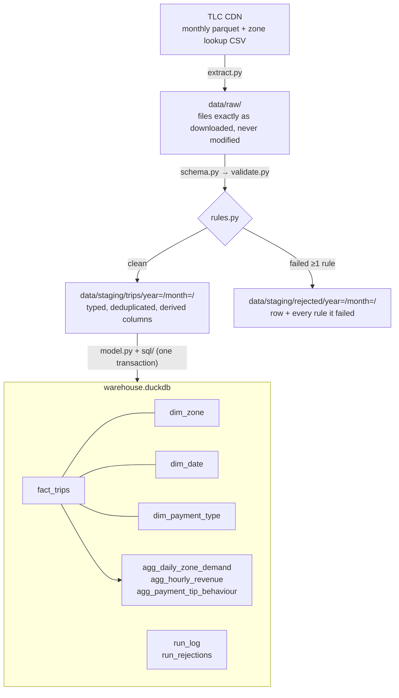

# NYC Taxi Pipeline

[](https://github.com/Emmanuel-Esplin/nyc-taxi-pipeline/actions/workflows/ci.yml)

> **Problem statement.** Ingest monthly NYC TLC Yellow Taxi trip data, validate and clean it,
> model it into an analytics-ready star schema, and produce reliable aggregates (demand by
> zone/hour, revenue, tipping behaviour), with reruns that are idempotent per month.

A batch pipeline in Python and DuckDB that runs locally or in Docker. Three months of 2025 data
(11.2M raw rows) load from scratch with one command, rerunning a month replaces it with exactly
the same rows, and every rejected row is kept along with the reason it was rejected.

## Architecture

Medallion layers on local storage. Each layer is partitioned by month, so a month can be
reprocessed without touching the other months.



| Stage | Module | What it does |
|---|---|---|
| Extract | [extract.py](src/pipeline/extract.py) | Downloads the month's file and the zone lookup. Skips the download if a raw file of the same size already exists. Writes go to a `.part` file that is then renamed, so a crash never leaves a partial file behind. |
| Type | [schema.py](src/pipeline/schema.py) | Maps raw columns to snake_case names without regard to case, using `TRY_CAST`. Columns missing from older files become typed NULLs. |
| Validate | [rules.py](src/pipeline/rules.py), [validate.py](src/pipeline/validate.py) | Tags each row with every rule it fails, then splits the rows into clean and quarantined. |
| Transform | [transform.py](src/pipeline/transform.py) | Derives `trip_key`, `pickup_date/hour/dow`, `trip_duration_min` and `tip_pct`, then writes the month's staging partition. |
| Model | [model.py](src/pipeline/model.py), [sql/](sql/) | Builds the dimensions, the fact table and the aggregates, all in one transaction per month. |
| Audit | [runlog.py](src/pipeline/runlog.py) | Adds one `run_log` row per run (including failed runs) and per-rule counts to `run_rejections`. |

## Running it

```bash
make install                              # .venv + dependencies (pinned by requirements.lock)
make run MONTH=2025-01                    # one month
make backfill START=2025-01 END=2025-03   # a range
make test                                 # unit + integration tests
make lint                                 # ruff

# Docker: no local Python needed. Outputs land in ./data
make docker-run MONTH=2025-01
make docker-backfill START=2025-01 END=2025-03
```

You can also call the CLI directly with `python -m pipeline run --month 2025-01` or
`--start 2025-01 --end 2025-03`. Settings live in [config.yaml](config.yaml) and contain no
hard-coded paths. Paths can be overridden with `PIPELINE_DATA_DIR`, `PIPELINE_WAREHOUSE_PATH`,
`PIPELINE_SQL_DIR` and `PIPELINE_SOURCE_DIR`. The last one points at a folder of
pre-downloaded files, which is how the tests and CI run offline.

## Data quality rules

Rules are SQL predicates that are TRUE when a row **fails**. A NULL result also counts as a
failure: if a row can't be shown to be valid, it is quarantined. Thresholds are set in
`config.yaml`.

| Rule | Check | 2025-01 | 2025-02 | 2025-03 |
|---|---|--:|--:|--:|
| `pickup_in_file_month` | Pickup falls inside the file's month | 22 | 31 | 33 |
| `dropoff_after_pickup` | Dropoff is strictly after pickup | 2,051 | 5,164 | 22,280 |
| `trip_duration_plausible` | Trip lasts < 24 h | 20 | 16 | 11 |
| `fare_amount_in_range` | 0 ≤ fare ≤ 1,000 | 144,121 | 182,661 | 208,729 |
| `trip_distance_in_range` | 0 ≤ distance ≤ 200 mi | 122 | 151 | 179 |
| `total_amount_in_range` | 0 ≤ total ≤ 1,500 | 63,039 | 55,183 | 68,689 |
| `passenger_count_positive` | passenger_count present and > 0 | 564,805 | 828,688 | 939,378 |
| `pickup_zone_known` / `dropoff_zone_known` | Location ID is in the zone lookup | 0 | 0 | 0 |
| `not_duplicate` | First occurrence of the natural key | 0 | 0 | 0 |
| **Rows in → clean** | | **3,475,226 → 2,849,118** | **3,577,543 → 2,688,808** | **4,145,257 → 3,115,197** |
| **Rejected** | | **18.0%** | **24.8%** | **24.8%** |

A single row can fail several rules, so the per-rule counts add up to more than the number of
rejected rows. In this data, the zone and duplicate rules never fire. They still matter as
guards, and the test fixture includes synthetic rows to prove they work.

Every run is reconciled: the row count in the raw file's parquet footer must equal the rows
read, clean rows must equal staged rows, and staged rows must equal the rows loaded into
`fact_trips`. If any count doesn't match, the run fails and nothing is loaded.

## Key design decisions

- **DuckDB, not Pandas, does the heavy lifting.** DuckDB reads parquet directly, runs in
  parallel and can spill to disk. A full month takes about 2–3 s, from validation through
  loading. Pandas is used only to build the small, hand-made DataFrames in the unit tests.
  Pushing 3–4M rows through Pandas row-wise is where memory problems start.
- **Rules are declared in Python and executed in SQL.** `rules.py` is the one place to read,
  test and document the rules, and the engine compiles them into a single vectorised query.
- **Bad rows are quarantined, not dropped.** Dropping rows silently hides upstream problems.
  Rejected rows are stored with a `reject_reason` and their position in the source file, so
  they can be inspected, fixed upstream or re-admitted later. Their counts form a time series
  in `run_rejections`.
- **Idempotent loads, one transaction per month.** The fact table and aggregates are loaded
  with `DELETE WHERE year_month = ?` followed by `INSERT`. The dimensions are rebuilt and the
  `run_log` row is written in the same transaction. A month is either fully loaded or left
  exactly as it was. Tests prove both properties: rerunning a month gives identical rows, and
  a failing aggregate rolls back the whole load.
- **`run_log` is append-only.** A rerun replaces the month's data but keeps the history of
  every attempt, including the error message of any failed run.
- **The surrogate `trip_key` is an md5 of the natural key.** Duplicate rows are quarantined on
  that same natural key, so `trip_key` is unique by construction, and a test checks this.
- **The SQL is written the way dbt models are.** Each file in `sql/` is a plain `SELECT`, and
  Python supplies the materialisation (`table` / `incremental`) and the `{{ variables }}`.
  Phase 2 can therefore be mostly a copy-paste into dbt.
- **The source schema changes over time, and the pipeline expects that.** TLC has renamed
  columns (`Airport_fee` vs `airport_fee`) and added new ones (`cbd_congestion_fee` from
  2025). Columns are matched without regard to case, and missing ones become typed NULLs.
- **DuckDB is pinned to `<2`.** DuckDB 2.0.0 returned wrong results (zero rows from filters,
  NULL from `min()`) when a table created inside a transaction was read after a bulk insert
  in that same transaction. That is the exact pattern of a first-time load. 1.5.6 is correct,
  and the rollback and idempotency tests would catch a regression.

## Findings (Jan–Mar 2025, 8.65M clean trips)

1. **Cash tips are invisible.** Card trips are tipped 93.9% of the time, with a median tip of
   27% of the fare. Cash trips show 0.0% tipped: $261 of recorded tips across 1.08M trips.
   TLC records card tips only, so any "tipping by payment type" analysis is really a measure
   of *recording* behaviour. Measured across all trips, the tip rate looks like 80%, when card
   riders actually tip 94% of the time.
2. **Demand is overwhelmingly Manhattan, plus JFK.** Manhattan accounts for 89.7% of pickups.
   The top zones are Midtown Center and Upper East Side South (5.1% each), followed by JFK
   Airport (4.7%), which puts Queens at 8.9%. Peak hour is 18:00 (630k trips). The highest
   average fare is at 05:00 ($38.52, against $27.31 at 18:00): there are few trips, but a large
   share of them are long airport runs.
3. **About a quarter of 2025 trips are "Flex Fare" rows with no passenger count.** There are
   917k such rows (payment_type 0) in March alone, and 15% of them have negative fares. The
   `passenger_count_positive` rule quarantines them. That is the right default for
   passenger-based metrics, but trip-volume or revenue reporting may want to re-admit them.
   Because they are quarantined rather than dropped, that is a query against the rejected
   files and needs no re-ingest.
4. **The Manhattan congestion-pricing fee (`cbd_congestion_fee`, started 5 Jan 2025) is
   reaching more trips.** It was charged on 64.6% of clean trips in January, rising to 75.8% in
   March ($1.38M → $1.77M per month).

## Project layout

```
src/pipeline/     cli, config, extract, schema, rules, validate, transform, model, runlog
sql/marts/        dim_zone, dim_date, dim_payment_type, fact_trips
sql/aggregates/   agg_daily_zone_demand, agg_hourly_revenue, agg_payment_tip_behaviour
tests/            rule unit tests, integration + idempotency + rollback tests
tests/fixtures/   10k-row sample of 2025-01 + zone lookup (built by scripts/make_fixture.py)
```

The fixture is a seeded random sample, plus up to 20 real rows for each rare failure, plus a
few synthetic duplicate and unknown-zone rows. A plain random sample would almost never
include the 22 out-of-month trips in 3.5M rows.

## Roadmap: Phase 2

| Phase 1 piece | Phase 2 replacement |
|---|---|
| CLI + Makefile loop for backfills | Airflow DAG: monthly schedule, `catchup=True`, extract → validate → load → dbt |
| `sql/` run by `model.py` | dbt with `dbt-duckdb`: staging → marts, `dbt test`, docs with a lineage graph |
| `rules.py` | Great Expectations (GX Core 1.x) suite at the raw → staging boundary, keeping the quarantine logic |
| README tables | Metabase dashboard on the marts, with screenshots committed to the repo |

All of these will run from a single `docker-compose.yml`.

## Data source

[NYC TLC Trip Record Data](https://www.nyc.gov/site/tlc/about/tlc-trip-record-data.page),
which is public. Raw data is never committed. Only the 10k-row test fixture is in the repo.
